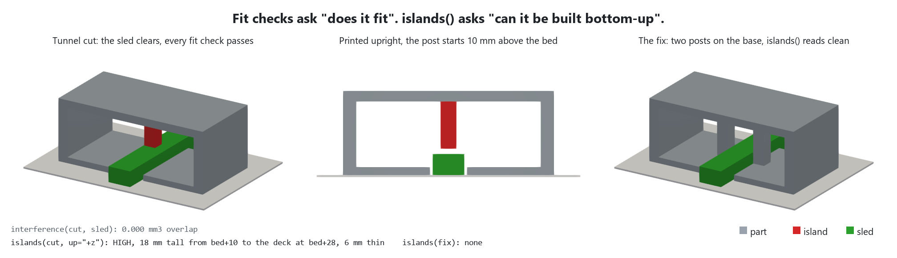
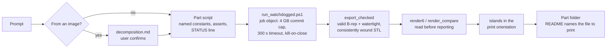

# cad-parts

[](https://github.com/ColinE0/cad-parts/actions/workflows/selftest.yml)
[](LICENSE)
[](https://claude.com/claude-code)


A Claude Code skill for designing 3D-printable parts with CadQuery. You ask for a part in plain
words ("an M4 spacer, 12 mm tall, 9 mm OD") or hand over a drawing, and you get back an STL and a
STEP that you can trust. Every build runs in a memory-capped subprocess. Every STL is checked
watertight before it leaves. Every part is rendered and actually looked at. A part that already
printed and fit is never edited in place.



## Contents

- [Why this exists](#why-this-exists)
- [What it does](#what-it-does)
- [Results](#results)
- [Install](#install)
- [Use](#use)
- [How it works](#how-it-works)
- [Repository layout](#repository-layout)
- [Reproduce the evals](#reproduce-the-evals)
- [Limitations](#limitations)
- [Skills demonstrated](#skills-demonstrated)
- [License and credits](#license-and-credits)

## Why this exists

Most "3D modeling with Claude" means asking for OpenSCAD or CadQuery code, running whatever comes
back, and opening the STL to see whether it looks right. Current models write that code well.
What goes wrong is everything around the code, and every rule in this skill comes from one of
those failures on real parts:

| What goes wrong | What the skill does about it |
|---|---|
| A CAD job inside a long-running process ran away with memory and took the whole machine down. | Every script runs in a Windows job object with a kernel-enforced memory cap and a timeout over the whole process tree. A runaway loses one run, not the machine. |
| A B-rep that passes `isValid()` still exports an STL the slicer calls non-manifold. | `export_checked` gates every export: valid solid, watertight and consistently wound STL, gentle auto-repair only when the volume moves less than 0.5 %. |
| Dimensions get "verified" by asserting an input constant against itself. | Features are checked by measuring the built solid, and a 6-view render is read before anything is reported. |
| The model edits the script for a part that already printed and fit, and the working version is gone. | Every script carries a `STATUS:` line. FROZEN parts are never edited; variants get a new file that names its delta. |
| A part passes every fit check and still cannot be printed: a pillar starts in mid-air on supports and snaps off partway through a 22-hour print. | `islands()` slices the part in its print orientation and flags material that starts above the bed. |
| A drawing's `Ø` gets read as a `9`, or a feature is skipped. | Parts from images start with a written feature decomposition the user confirms, and end with a side-by-side render against the drawing. |

## What it does

- Writes a CadQuery script per part, every dimension a named constant, with asserts on the
  bounding box and on derived features.
- Runs it through `run_watchdogged.ps1` (4 GB cap and 300 s timeout by default; exit 137 names
  whether the cap or the clock fired).
- Exports STEP plus STL through the watertight gate, renders 6 views, checks for islands.
- Keeps each part in its own folder with a README that names the one file to print.
- Repairs broken STLs with numbers (open edges, loops, winding) instead of guesses.
- Chains dependent parts to a pinned parent (`current.json` plus a geometric fingerprint), so a
  bracket fails loudly when the plate it bolts to changes underneath it.
- Ships `references/gotchas.md`: the OpenCASCADE and toolchain traps it has already hit, each
  with the date and the part it broke.

## Results

Eight eval prompts, three setups, 24 headless Claude Code runs on 2026-11-14, one run per cell
(full write-up in [evals/RESULTS.md](evals/RESULTS.md)).

**The first six:** a spacer from a spec, a variant of a frozen part, a broken STL, a bracket on a
chained plate, a bracket from a drawing, and a build the memory cap keeps killing.

| | Fable 5.1 medium + skill | Fable 5.2 high + skill | Fable 5.2 high, no skill |
|---|---|---|---|
| Part geometry right, measured (5 parts) | 5/5 | 5/5 | 5/5 |
| CadQuery processes run with no memory cap | 0 | 0 | 13 |
| STL checked watertight before hand-off | 5/5 | 5/5 | 2/5 |
| Render made and opened | 5/5 | 5/5 | 1/5 |
| Drawing decomposed in writing before modeling | yes | yes | no |
| Memory kill diagnosed without raising the cap | yes | yes | no |
| Tokens / cost at API list prices, all six | 2.15 M / $6.18 | 2.23 M / $7.28 | 1.08 M / $3.46 |

**Two harder ones,** rebuilt from failures the skill was written after: a tunnel cut that leaves
a post hanging in mid-air, and a bracket script still pointing at a plate the chain has moved
past.

| | Fable 5.1 medium + skill | Fable 5.2 high + skill | Fable 5.2 high, no skill |
|---|---|---|---|
| Hanging post caught; delivered part island-free, measured | yes | yes | yes |
| Moved plate caught; bracket fits the live plate, measured | yes | yes | yes |
| Island measured with `islands()`, not just reasoned about | no | yes | no |
| Next plate move fails loudly (parent pinned in the script) | yes | yes | no |
| CadQuery processes run with no memory cap | 1 | 0 | 5 |
| STL checked watertight / render made and opened | 2/2, 2/2 | 2/2, 2/2 | 1/2, 0/2 |
| Tokens / cost at API list prices, both | 1.19 M / $3.17 | 1.09 M / $3.60 | 0.33 M / $1.24 |

The honest reading: on small parts, a current model gets the geometry right on its own, and in a
short prompt about a small part it also spots the two failures the harder evals rebuild. The
skill does not make it smarter there; it makes the work safe and checkable. It measures what the
bare model reasons about, keeps CAD processes behind the memory cap (one slip in 16 skill runs:
a bare `python -c` that imported the helpers to read their signatures), gets the memory kill
right instead of "raise the limit", and pins a dependent part to its parent so the next change
fails loudly instead of passing quietly. It costs two to four times the tokens. The original
failures happened deep in long sessions on large parts; evals that bury them that deep are next.
A ninth prompt, a non-uniform scale of an imported STEP, is built but was not run: replayed under
the runner, the op once blamed for a machine crash finished in 0.24 s with no extra memory.

## Install

Windows 10 or 11, about 10 minutes, once.

1. Install [Claude Code](https://claude.com/claude-code).
2. Install [uv](https://docs.astral.sh/uv/) (Python installer), then reopen PowerShell:
   ```powershell
   powershell -ExecutionPolicy ByPass -c "irm https://astral.sh/uv/install.ps1 | iex"
   ```
3. Clone this repo and run the installer from its folder:
   ```powershell
   git clone https://github.com/ColinE0/cad-parts
   cd cad-parts
   powershell -ExecutionPolicy Bypass -File .\setup\install.ps1
   ```
   It creates `C:\cadquery-venv` (Python 3.14 and the exact versions in
   `setup\requirements.txt`, a few hundred MB), installs `cq_helpers.py` into it, copies the
   skill to `%USERPROFILE%\.claude\skills\cad-parts`, and runs the self-test through the runner.
   It ends with `DONE` and "All set". Re-running is safe; `-Force` replaces an installed skill.
4. Restart Claude Code.

## Use

Ask for a part, or type `/cad-parts` and what you want. The first time, Claude asks where your
parts should live and can write that folder into the skill.

- Give real numbers (calipers beat guesses) and say which side is the front.
- When a print fits, say so: Claude marks the script FROZEN, and later changes go to a new file.
- Hand it a drawing, a photo or a broken STL and say what you want; it will propose before it
  builds when something load-bearing is open.

## How it works



**The runner.** `C:\cadquery-venv\Scripts\python.exe` is a small uv trampoline that starts the
real interpreter as a child, so watching the launcher's memory shows about 10 MB while the build
eats gigabytes. The runner starts the launcher suspended, puts it in a job object with a
job-wide committed-memory limit and kill-on-close, then resumes it. The interpreter and anything
it spawns are born inside the job. An allocation past the cap is refused by the kernel, the
runner kills the tree with `TerminateJobObject`, and if the runner itself dies the job takes the
tree with it. It compiles its C# with Windows PowerShell 5.1 too.

**The export gate.** `export_checked` asserts B-rep validity, writes the STEP, meshes a copy of
the shape (so the caller's solid is never meshed in place), and reloads the STL with trimesh:
watertight, consistent winding, else a gentle vertex merge and hole fill that is kept only if the
volume moves less than 0.5 %. Anything else stops the build.

**Islands.** `islands(part, up="+z")` slices the part every layer in its print orientation and
joins regions layer to layer by overlap. A region that starts above the bed and only later joins
grounded material is an island; tall or slender ones are rated HIGH.

**The rest of `cq_helpers`.** `describe`/`diff`/`is_noop` (geometry truth blocks, and a check
for OpenCASCADE silently returning its input unchanged), `interference` (numeric overlap and
clearance), `hints_for_error` (maps cryptic OCCT errors to fixes, installed as an excepthook),
the chain pointer, mesh-to-solid helpers and engraved-text sizing. `scripts/test_cq_helpers.py`
covers all of it with plain asserts.

## Repository layout

| Path | What |
|---|---|
| `cad-parts/SKILL.md` | the skill: non-negotiables, workflow, conventions, helper API |
| `cad-parts/references/` | `gotchas.md` (traps already hit) and the reference-image decomposition procedure |
| `cad-parts/scripts/run_watchdogged.ps1` | the memory-capped runner |
| `cad-parts/scripts/test_cq_helpers.py` | self-test for the helpers (11 groups, ends with `DONE`) |
| `cad-parts/venv-modules/cq_helpers.py` | export gate, renders, islands, interference, chain pointer |
| `setup/` | `install.ps1` and the pinned `requirements.txt` |
| `evals/` | the 9 eval prompts (eval 7 built, not run), their input files, the harness and the grader; `harness/make_assets.py` rebuilds the binary inputs |
| `docs/` | the picture above and `make_readme_image.py`, which draws it from eval 8's part with the helpers |
| `.github/workflows/selftest.yml` | CI: runs `install.ps1` on a clean Windows runner |

## Reproduce the evals

The harness runs each eval through headless Claude Code (`claude -p`) in a fresh folder, inside
a job object with a 12 GB cap and a 45-minute timeout, with `--safe-mode` so no personal
CLAUDE.md, skills, plugins or hooks leak in. The skill arm gets the skill's path in an appended
system prompt; the baseline arm gets the same environment note and nothing else. Both get the
eval prompt verbatim. Needs PowerShell 7 and a Claude Code new enough for the model you pick.

```powershell
cd evals
uv venv venv --python 3.14 --seed
uv pip install --python venv\Scripts\python.exe -r ..\setup\requirements.txt
New-Item -ItemType Directory skill-under-test | Out-Null
Copy-Item ..\cad-parts skill-under-test -Recurse
pwsh -File harness\run_batch.ps1 -Jobs fable52-high:skill:1,fable52-high:baseline:1 -Parallel 2
& ..\cad-parts\scripts\run_watchdogged.ps1 -Script harness\grade.py -Python (Resolve-Path venv\Scripts\python.exe) -TimeoutSec 600
```

`run_eval.ps1` finds the Claude desktop app's bundled CLI by default; pass `-ClaudeExe` to use
another. `grade.py` measures every STL and STEP a run produced, checks the inputs are
byte-identical afterwards, runs each eval's own checks (a bracket's seat and hole axes, the sled's
clearance plus an island check, which plate a bracket fits), and reads the transcript for how
many Python runs went through the runner, which renders were opened, and any path the run
touched outside its own folder.

## Limitations

- **Windows only.** The runner is a Windows job object driven from PowerShell. macOS and Linux
  would need the same idea through cgroups or `setrlimit`; not written yet.
- **CadQuery / OpenCASCADE only**, and the defaults lean FDM and PLA (fastener clearances, the
  island risk thresholds).
- **Eight evals run, one run per configuration.** Model output varies run to run, so each cell in
  the results is one sample, not a rate. The two harder evals rebuild their failures on small
  parts in short prompts, where the bare model catches them too.
- **The baseline has no helper library.** "No skill" also means no `cq_helpers`, so the
  comparison is skill plus helpers against the bare model in the same venv.
- **Headless runs cannot ask questions.** Both arms were told to write questions and assumed
  answers to `QUESTIONS.md` and carry on, so the confirm-before-building gates are graded on
  what was written down, not on a real conversation.
- **CI skips the render group.** GitHub's Windows runners have no OpenGL 3.2, which VTK's
  offscreen renderer needs (`CADPARTS_SKIP_RENDER=1`); every local install runs it.

## Skills demonstrated

| Area | Where it shows |
|---|---|
| Windows systems programming: job objects, suspended process start, kernel commit limits, I/O completion ports | `scripts/run_watchdogged.ps1`, `evals/harness/EvalSandbox.cs` |
| Computational geometry: B-rep validity, mesh repair, float32 snapping, layer-sliced island detection | `venv-modules/cq_helpers.py` |
| CAD automation with CadQuery / OpenCASCADE | `SKILL.md`, `cq_helpers.py`, `references/gotchas.md` |
| AI agent design: skill authoring, hard gates, a failure-mode catalog built from real breaks | `SKILL.md`, `references/` |
| Evaluation design: isolated A/B runs, sandboxed agents, scripted grading | `evals/harness/` |
| CI that tests the documented install on a clean machine | `.github/workflows/selftest.yml` |

## License and credits

Apache License 2.0; see [LICENSE](LICENSE) and [NOTICE](NOTICE). Copyright 2026 Colin Ezra
Wilder.

Built with [Claude Code](https://claude.com/claude-code). The skill, its helpers and the eval
harness were written in collaboration with Claude (Anthropic), and every rule in them comes from
a real part that failed on a real printer.

The reference-image decomposition procedure is adapted from the vision-decompose skill in
Reshef Elisha's [jarvis-onshape-mcp](https://github.com/ReshefElisha/jarvis-onshape-mcp) (MIT),
whose truth-telling feedback design also inspired the geometry checks in `cq_helpers`; see
[NOTICE](NOTICE). The CAD itself runs on [CadQuery](https://github.com/CadQuery/cadquery) and
Open CASCADE.
