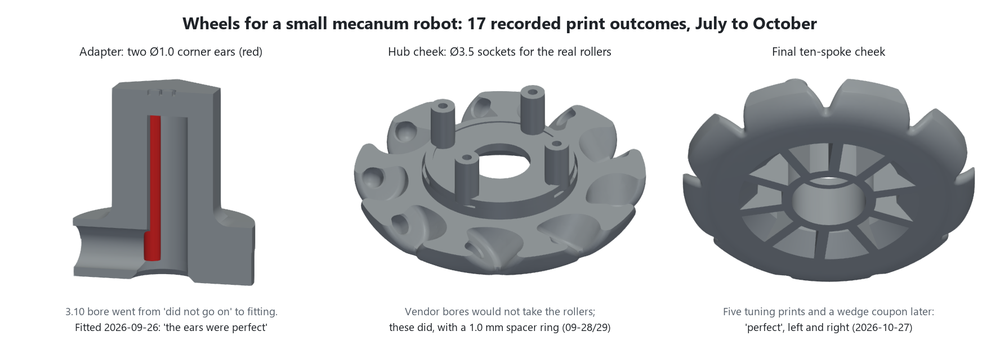
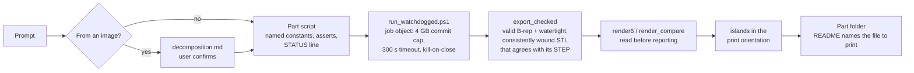

# cad-parts

[](https://github.com/ColinE0/cad-parts/actions/workflows/selftest.yml)
[](LICENSE)
[](https://claude.com/claude-code)


A Claude Code skill (Windows) for designing 3D-printable parts with CadQuery. You ask for a part in plain
words ("an M4 spacer, 12 mm tall, 9 mm OD") or hand over a drawing, and you get back an STL and a
STEP that were measured and checked before you see them. Builds go through a memory-capped runner
(a hook can make that a rule). Every STL has to pass a watertight check and agree with its STEP.
Every part is rendered and the render is read. A part that already printed and fit is never
edited in place. None of that proves a part will fit or print well: the
[physical record](#physical-record) shows how often it still doesn't, and why.

> **Windows 10/11 only for now.** The memory cap is a Windows job object driven from PowerShell.
> macOS and Linux would need the same idea built on cgroups or `setrlimit`, which is not written
> yet (see [Limitations](#limitations)). The rest of the skill is plain CadQuery and Python.



Three parts from a small robot's mecanum wheels, all printed and fitted. Getting there took 17
recorded print outcomes; [the story](#example-the-wheels) is below.

## Quickstart

With [Claude Code](https://claude.com/claude-code), git and [uv](https://docs.astral.sh/uv/)
installed:

```powershell
git clone https://github.com/ColinE0/cad-parts
cd cad-parts
powershell -ExecutionPolicy Bypass -File .\setup\install.ps1
```

Restart Claude Code and ask for a part: "an M4 spacer, 12 mm tall, 9 mm OD". You get a folder with
the CadQuery script, a STEP, a checked STL, a 6-view render and a README naming the file to print.
Details, updates and the optional hook are under [Install](#install).

## Contents

- [Quickstart](#quickstart)
- [Why this exists](#why-this-exists)
- [What it does](#what-it-does)
- [Results](#results)
- [Physical record](#physical-record)
- [Install](#install)
- [Use](#use)
- [How it works](#how-it-works)
- [Repository layout](#repository-layout)
- [Reproduce the evals](#reproduce-the-evals)
- [Limitations](#limitations)
- [Skills demonstrated](#skills-demonstrated)
- [License and credits](#license-and-credits)

## Why this exists

Most "3D modeling with Claude" means asking for OpenSCAD or CadQuery code, running whatever comes
back, and opening the STL to see whether it looks right. Current models write that code well.
What goes wrong is everything around the code, and every rule in this skill comes from one of
those failures on real parts:

| What goes wrong | What the skill does about it |
|---|---|
| A CAD job inside a long-running process ran away with memory and took the whole machine down. | Scripts run through a runner that puts them in a Windows job object, with a kernel-enforced memory cap and a timeout over the whole process tree. A runaway loses one run, not the machine. Using the runner is the skill's rule; the optional hook makes Claude Code refuse to skip it. |
| A B-rep that passes `isValid()` still exports an STL the slicer calls non-manifold. | `export_checked` gates every export: valid solid, watertight and consistently wound STL, gentle auto-repair only when the volume moves less than 0.5 %, and an STL that matches the STEP read back from disk in size and volume. |
| Dimensions get "verified" by asserting an input constant against itself. | Features are checked by measuring the built solid, and a 6-view render is read before anything is reported. |
| The model edits the script for a part that already printed and fit, and the working version is gone. | Every script carries a `STATUS:` line. FROZEN parts are never edited; variants get a new file that names its delta. |
| A part passes every fit check and still cannot be printed: a pillar starts in mid-air on supports and snaps off partway through a 22-hour print. | `islands()` slices the part in its print orientation and flags material that starts above the bed. |
| A drawing's `Ø` gets read as a `9`, or a feature is skipped. | Parts from images start with a written feature decomposition the user confirms, and end with a side-by-side render against the drawing. |

## What it does

- Writes a CadQuery script per part, every dimension a named constant, with asserts on the
  bounding box and on derived features.
- Runs it through `run_watchdogged.ps1` (4 GB cap and 300 s timeout by default; exit 137 names
  whether the cap or the clock fired).
- Exports STEP plus STL through the watertight gate, renders 6 views, checks for islands.
- Keeps each part in its own folder with a README that names the one file to print.
- Repairs broken STLs with numbers (open edges, loops, winding) instead of guesses.
- Chains dependent parts to a pinned parent (`current.json` plus a geometric fingerprint), so a
  bracket fails loudly when the plate it bolts to changes underneath it.
- Ships `references/gotchas.md`: the OpenCASCADE and toolchain traps it has already hit, each
  with the date and the part it broke.

## Results

Eleven eval prompts, 38 headless Claude Code runs on 2026-11-14 and 15: one run per cell, except
the two buried island evals, which ran three times per setup (full write-up in
[evals/RESULTS.md](evals/RESULTS.md)). The buried evals come first: they are where the skill
changed the outcome. In the others, both setups mostly got the part right.

**Three buried ones.** The original failures happened deep in real projects, so these bury the
same two the way they happened: a slot asked for in a 230 mm robot shell with a dozen features,
which quietly takes the whole foot of the wall between the wheel arches; a small edit to a part
in a 17-file project whose shared helper still loads an old plate; and the last of four routine
edits, where bigger wheel arches leave that same wall hanging. No prompt names the problem.
Fable 5.2 high only (the 5.1 medium arm was not run).

| | Fable 5.2 high + skill | Fable 5.2 high, no skill |
|---|---|---|
| Hanging wall seen (2 evals x 3 runs) | 6/6, measured with `islands()` | 6/6, reasoned about |
| Shell recommended to print free of islands, measured | 6/6: wall cut away, knock-out webs, or breakaway posts and ties | 0/6: shipped on supports every time |
| Stale plate caught; part fits the live plate (1 run) | yes | yes |
| CadQuery processes run with no memory cap (all 7 runs) | 1 | 73 |
| Runs that made a render (all 7) | 7/7 | 3/7 |
| Cost at API list prices, all 7 runs | $32.85 | $17.92 |

**The first six:** a spacer from a spec, a variant of a frozen part, a broken STL, a bracket on a
chained plate, a bracket from a drawing, and a build the memory cap keeps killing.

| | Fable 5.1 medium + skill | Fable 5.2 high + skill | Fable 5.2 high, no skill |
|---|---|---|---|
| Part geometry right, measured (5 parts) | 5/5 | 5/5 | 5/5 |
| CadQuery processes run with no memory cap | 0 | 0 | 13 |
| STL checked watertight before hand-off | 5/5 | 5/5 | 2/5 |
| Render made and opened | 5/5 | 5/5 | 1/5 |
| Drawing decomposed in writing before modeling | yes | yes | no |
| Memory kill diagnosed without raising the cap | yes | yes | no |
| Tokens / cost at API list prices, all six | 2.15 M / $6.18 | 2.23 M / $7.28 | 1.08 M / $3.46 |

**Two harder ones,** rebuilt from failures the skill was written after: a tunnel cut that leaves
a post hanging in mid-air, and a bracket script still pointing at a plate the chain has moved
past.

| | Fable 5.1 medium + skill | Fable 5.2 high + skill | Fable 5.2 high, no skill |
|---|---|---|---|
| Hanging post caught; delivered part island-free, measured | yes | yes | yes |
| Moved plate caught; bracket fits the live plate, measured | yes | yes | yes |
| Island measured with `islands()`, not just reasoned about | no | yes | no |
| Next plate move fails loudly (parent pinned in the script) | yes | yes | no |
| CadQuery processes run with no memory cap | 1 | 0 | 5 |
| STL checked watertight / render made and opened | 2/2, 2/2 | 2/2, 2/2 | 1/2, 0/2 |
| Tokens / cost at API list prices, both | 1.19 M / $3.17 | 1.09 M / $3.60 | 0.33 M / $1.24 |


The honest reading: on small parts in short prompts, a current model gets the geometry right on
its own and spots both rebuilt failures. The skill does not make it smarter there; it makes the
work safe and checkable. It measures what the bare model reasons about, keeps CAD processes
behind the memory cap (two slips in 23 skill runs, both a bare `python -c` that imported the
helpers to read their signatures; the hook now refuses that), gets the memory kill right instead
of "raise the limit", and pins a dependent part to its parent so the next change fails loudly
instead of passing quietly. Buried deep, the difference shows up in the outcome: in six runs per
setup the same model saw the same hanging wall every time, but without the skill it called it a
support setting and shipped it all six times, which is exactly the call that snapped a real
22-hour print. With the skill it refused all six times and recommended a printable part. Both arms found the stale plate, since the bare model read all 17 files first. The skill
costs two to four times the tokens. A twelfth prompt, a non-uniform scale of an imported STEP, is
built but was not run: replayed under the runner, the op once blamed for a machine crash finished
in 0.24 s with no extra memory.

## Physical record

The evals are small prompts. The real record is every print reported since this workflow started
on 2026-07-15: 79 printed revisions of parts made with it, 53 of them with a reported verdict.

| Outcome | Prints |
|---|---|
| Worked | 21 |
| Failed: the geometry was wrong | 18 |
| Failed: a number or requirement in the request was wrong | 8 |
| Failed: the printer or slicer | 4 |
| Failed: cause not established | 2 |

There were also 12 deliberate fit-tuning series (bore and spacing ladders, at least 20 prints) and
14 printed parts with no recorded outcome. The tally comes from the parts' `STATUS:` lines, the
part-folder notes and the session history; most verdicts are a fit by hand, not a measurement.

**What it says about the checks.** Only 2 of the 18 geometry failures would be caught by a gate
in the skill today: a pillar that printed in mid-air (`islands()` exists because of it) and a lid
that would not close (`interference()`). The other 16 were insertion paths blocked by a feature,
loads that crushed or split a part, a vendor model that did not match the real part, and
tolerances and threads that took a ladder to find. No print failed because a working part was
edited or an STL was bad: those gates stop their problems before the printer does. The next
checks belong where the failures are: insertion paths, a minimum clearance rather than zero
overlap, and measuring the real part before trusting its model.

### Example: the wheels

The three parts pictured at the top took 17 recorded print outcomes from July to October:

| Date | Print | Outcome |
|---|---|---|
| 08-07 | five-rung bore ladder for the motor-to-wheel adapter | 3.15 mm glove-tight, 3.10 would not go on, 3.05 had to be forced |
| 08-12 | the adapters on the assembled robot | some wheels rub the body: the CAD had a zero gap, which an overlap check reads as fine |
| 09-26 | the ear ladder ([worked example](examples/n20-ear-ladder)) | the 3.10 bore slides on with two corner ears: "the ears were perfect", and every adapter since has them |
| 09-28 | hub cheeks cut from the vendor's wheel model | the real rollers would not go in |
| 09-28 to 09-29 | cheeks with Ø3.5 ball sockets, plus a 1.0 mm spacer ring | the rollers spin free; frozen |
| 09-29 | a plain cheek with the vendor's Ø1.6 screw posts | two posts split |
| 10-24 | the real rollers, calipered | 19.42 mm long (model 19.50), ball ends Ø3.04 (model 3.0) |
| 10-24 to 10-26 | ten-spoke wheel, five tuning prints | rollers rubbing, then "pretty good", 0.15 mm short, rims dragging on the floor, and finally too tight (reverted) |
| 10-27 | a wedge coupon that tests roller spacing without a whole wheel | "did great", and picked the final spacing |
| 10-27 | the final ten-spoke wheels, left and right | "perfect" |
| 10-28 | the same wheels with engraved L/R marks | one wheel struggles to turn; cause not established |

The adapter's ear ladder is published in full in [examples/n20-ear-ladder](examples/n20-ear-ladder):
the frozen script, its falsifiable prediction, every rung's STEP, STL and render, and a rebuild that
reproduces the printed rungs' volumes exactly. The cheeks and wheels are built on the wheel
vendor's CAD model, so only their renders are shown.

## Install

Windows 10 or 11, about 10 minutes, once.

1. Install [Claude Code](https://claude.com/claude-code).
2. Install [uv](https://docs.astral.sh/uv/) (Python installer), then reopen PowerShell:
   ```powershell
   powershell -ExecutionPolicy ByPass -c "irm https://astral.sh/uv/install.ps1 | iex"
   ```
3. Clone this repo and run the installer from its folder:
   ```powershell
   git clone https://github.com/ColinE0/cad-parts
   cd cad-parts
   powershell -ExecutionPolicy Bypass -File .\setup\install.ps1
   ```
   It creates `C:\cadquery-venv` (Python 3.14 and the exact versions in
   `setup\requirements.txt`, a few hundred MB), installs `cq_helpers.py` into it, copies the
   skill to `%USERPROFILE%\.claude\skills\cad-parts`, and runs the self-test through the runner.
   It ends with `DONE` and "All set".

   Re-running is safe: a matching install is left as it is and tested again. If a different
   copy is installed (an older version, or one you edited, such as your parts folder written
   into `SKILL.md`), the installer stops before changing anything. `-Force` then updates the
   skill and its helpers together and keeps the old folder in
   `%USERPROFILE%\.claude\cad-parts-backups`. For a venv somewhere else, pass `-VenvPath` and
   set `CADPARTS_PYTHON` to its `python.exe`.
4. Recommended: register the hook that makes the runner a rule (see
   [Making the runner a rule](#making-the-runner-a-rule)).
5. Restart Claude Code.

## Use

Ask for a part, or type `/cad-parts` and what you want. The first time, Claude asks where your
parts should live and can write that folder into the skill.

- Give real numbers (calipers beat guesses) and say which side is the front.
- When a print fits, say so: Claude marks the script FROZEN, and later changes go to a new file.
- Hand it a drawing, a photo or a broken STL and say what you want; it will propose before it
  builds when something load-bearing is open.

## How it works



**The runner.** `C:\cadquery-venv\Scripts\python.exe` is a small uv trampoline that starts the
real interpreter as a child, so watching the launcher's memory shows about 10 MB while the build
eats gigabytes. The runner starts the launcher suspended, puts it in a job object with a
job-wide committed-memory limit and kill-on-close, then resumes it. The interpreter and anything
it spawns are born inside the job. An allocation past the cap is refused by the kernel, the
runner kills the tree with `TerminateJobObject`, and if the runner itself dies the job takes the
tree with it. It compiles its C# with Windows PowerShell 5.1 too. Every build starts without
`PYTHONOPTIMIZE`, so a part script's own asserts always run.

### Making the runner a rule

The runner caps only what it launches, and the skill tells Claude to launch everything through
it. `cad-parts/hooks/require_runner.py` turns that instruction into a rule: registered as a Claude
Code hook, it reads every command Claude sends to its Bash or PowerShell tool and refuses one that
starts the venv's Python directly, with the runner command to use instead. `-m pip`, `--version`
and commands that only name the venv path (copying a file into it, listing it) still go through.
A command counts as the runner only when the program it starts is `run_watchdogged.ps1` (called
directly or through `powershell -File`); the name in an argument or a comment does not count, and
a command string handed to a new shell (`powershell -Command`, `bash -c`) is read too.
Add it to `%USERPROFILE%\.claude\settings.json`, merging with any hooks you already have:

```json
{
  "hooks": {
    "PreToolUse": [
      {
        "matcher": "Bash|PowerShell",
        "hooks": [
          {
            "type": "command",
            "command": "\"C:/cadquery-venv/Scripts/python.exe\" -I \"C:/Users/<you>/.claude/skills/cad-parts/hooks/require_runner.py\"",
            "timeout": 10
          }
        ]
      }
    ]
  }
}
```

It is plain Python with no imports beyond the standard library, about 0.15 s per shell command.
`hooks/test_require_runner.py` checks 22 commands it must refuse and 17 it must let through; CI
runs it on every push.

**The export gate.** `export_checked` requires a valid B-rep, writes the STEP, meshes a copy of
the shape (so the caller's solid is never meshed in place), and reloads the STL with trimesh:
watertight, consistent winding, else a gentle repair that is kept only if the volume moves less
than 0.5 %. The repair only merges vertices closer than 0.0001 mm and patches open loops of three
or four edges, which a meshed solid has only where its tessellation cracked. That keeps it to
hairline defects, and the STEP comparison below checks the result again, but it is not a proof
that every small feature survives: a tiny opening that meshes to a three- or four-edge loop
could be patched. Then the STEP is read back from disk
and the STL has to agree with it: bounding box within 0.05 mm or 0.5 % of the part's size,
volume within 1.5 %. Every check raises `GateError` explicitly rather than using `assert`, so
`python -O` cannot switch the gate off. Any failed check stops the build.

**Islands.** `islands(part, up="+z")` slices the part every layer in its print orientation and
joins regions layer to layer by overlap. A region that starts above the bed and only later joins
grounded material is an island; tall or slender ones are rated HIGH.

**What "checked" means.** The skill keeps three levels apart, and only you can grant the last:

1. **Checked:** every gate above passed, and so did the script's own asserts on the measured
   part (bounding box, feature sizes, clearance to modeled hardware).
2. **Print-checked:** `islands()` found nothing HIGH in the orientation the part will print in.
   That is a heuristic, not a printability guarantee: there is no minimum wall-thickness or
   feature-size check yet.
3. **Physically tested:** printed, and you said it fits. Only then does the script's `STATUS:`
   line change from `trial, unprinted` to something like `printed 2026-09-08 (K2), fitted,
   FROZEN`. A FROZEN script is never edited again; changes go into a new file.

**The rest of `cq_helpers`.** `describe`/`diff`/`is_noop` (geometry truth blocks, and a check
for OpenCASCADE silently returning its input unchanged), `interference` (numeric overlap and
clearance), `hints_for_error` (maps cryptic OCCT errors to fixes, installed as an excepthook),
the chain pointer, mesh-to-solid helpers and engraved-text sizing. `scripts/test_cq_helpers.py`
covers all of it with plain asserts.

## Repository layout

| Path | What |
|---|---|
| `cad-parts/SKILL.md` | the skill: non-negotiables, workflow, conventions, helper API |
| `cad-parts/references/` | `gotchas.md` (traps already hit) and the reference-image decomposition procedure |
| `cad-parts/scripts/run_watchdogged.ps1` | the memory-capped runner |
| `cad-parts/hooks/` | `require_runner.py`, the optional Claude Code hook that refuses the venv's Python outside the runner, and its test |
| `cad-parts/scripts/test_cq_helpers.py` | self-test for the helpers (11 groups, ends with `DONE`) |
| `cad-parts/venv-modules/cq_helpers.py` | export gate, renders, islands, interference, chain pointer |
| `setup/` | `install.ps1` and the pinned `requirements.txt` |
| `evals/` | the 12 eval prompts (7 not run; 10 to 12 run in the two Fable 5.2 arms only), their input files and project folders, the harness and the grader; `harness/make_assets.py` rebuilds the binary inputs |
| `examples/n20-ear-ladder/` | a complete worked example: a frozen, printed and fitted part's script, its STEP, STL and renders, and a rebuild log |
| `docs/` | the pictures: `island-check.png` (drawn by `make_readme_image.py` from eval 8's part) and `wheel-chain.png` (rendered from the wheel parts; the cheeks' CAD is the vendor's, so that script stays private) |
| `.github/workflows/selftest.yml` | CI: runs `install.ps1` on a clean Windows runner |

## Reproduce the evals

The harness runs each eval through headless Claude Code (`claude -p`) in a fresh folder, inside
a job object with a 12 GB cap and a 45-minute timeout, with `--safe-mode` so no personal
CLAUDE.md, skills, plugins or hooks leak in. The skill arm gets the skill's path in an appended
system prompt; the baseline arm gets the same environment note and nothing else. Both get the
eval prompt verbatim. Needs PowerShell 7 and a Claude Code new enough for the model you pick.

```powershell
cd evals
uv venv venv --python 3.14 --seed
uv pip install --python venv\Scripts\python.exe -r ..\setup\requirements.txt
New-Item -ItemType Directory skill-under-test | Out-Null
Copy-Item ..\cad-parts skill-under-test -Recurse
pwsh -File harness\run_batch.ps1 -Jobs fable52-high:skill:1,fable52-high:baseline:1 -Parallel 2
& ..\cad-parts\scripts\run_watchdogged.ps1 -Script harness\grade.py -Python (Resolve-Path venv\Scripts\python.exe) -TimeoutSec 600
```

`run_eval.ps1` finds the Claude desktop app's bundled CLI by default; pass `-ClaudeExe` to use
another. `grade.py` measures every STL and STEP a run produced, checks the inputs are
byte-identical afterwards, runs each eval's own checks (a bracket's seat and hole axes, the sled's
clearance plus an island check, which plate a bracket fits), and reads the transcript for how
many Python runs went through the runner, which renders were opened, and any path the run
touched outside its own folder.

## Limitations

- **Windows only.** The runner is a Windows job object driven from PowerShell. macOS and Linux
  would need the same idea through cgroups or `setrlimit`; not written yet.
- **CadQuery / OpenCASCADE only**, and the defaults lean FDM and PLA (fastener clearances, the
  island risk thresholds).
- **Eleven evals run, mostly one run per configuration.** Model output varies run to run, so most
  cells in the results are one sample, not a rate; only the two buried island evals ran three
  times per setup (6/6 against 0/6), and that is still a small sample. The two harder evals rebuild their failures on small
  parts in short prompts, where the bare model catches them too; evals 10 to 12 bury them deeper,
  and ran in the two Fable 5.2 arms only. The buried plate drift did not stay buried: in a
  17-file project the bare model reads every file first.
- **The baseline has no helper library.** "No skill" also means no `cq_helpers`, so the
  comparison is skill plus helpers against the bare model in the same venv.
- **Headless runs cannot ask questions.** Both arms were told to write questions and assumed
  answers to `QUESTIONS.md` and carry on, so the confirm-before-building gates are graded on
  what was written down, not on a real conversation.
- **The memory cap needs the runner.** It covers what `run_watchdogged.ps1` launches. Without the
  hook, using the runner is an instruction, and the evals caught one skill run starting CadQuery
  outside it; with the hook registered, Claude Code refuses those calls. The hook is a guard
  against forgetting, not a security boundary: it reads command text with patterns, so a
  determined workaround (a script that launches Python itself, a variable built up in pieces) can
  still get past it, and commands Claude does not send through its Bash or PowerShell tools are
  outside its reach.
- **CI skips the render group.** GitHub's Windows runners have no OpenGL 3.2, which VTK's
  offscreen renderer needs (`CADPARTS_SKIP_RENDER=1`); every local install runs it.

## Skills demonstrated

| Area | Where it shows |
|---|---|
| Windows systems programming: job objects, suspended process start, kernel commit limits, I/O completion ports | `scripts/run_watchdogged.ps1`, `evals/harness/EvalSandbox.cs` |
| Computational geometry: B-rep validity, mesh repair, float32 snapping, layer-sliced island detection | `venv-modules/cq_helpers.py` |
| CAD automation with CadQuery / OpenCASCADE | `SKILL.md`, `cq_helpers.py`, `references/gotchas.md` |
| AI agent design: skill authoring, hard gates, a failure-mode catalog built from real breaks | `SKILL.md`, `references/` |
| Evaluation design: isolated A/B runs, sandboxed agents, scripted grading | `evals/harness/` |
| CI that tests the documented install on a clean machine | `.github/workflows/selftest.yml` |

## License and credits

Apache License 2.0; see [LICENSE](LICENSE) and [NOTICE](NOTICE). Copyright 2026 Colin Ezra
Wilder.

Built with [Claude Code](https://claude.com/claude-code). The skill, its helpers and the eval
harness were written in collaboration with Claude (Anthropic), and every rule in them comes from
a real part that failed on a real printer.

The reference-image decomposition procedure is adapted from the vision-decompose skill in
Reshef Elisha's [jarvis-onshape-mcp](https://github.com/ReshefElisha/jarvis-onshape-mcp) (MIT),
whose truth-telling feedback design also inspired the geometry checks in `cq_helpers`; see
[NOTICE](NOTICE). The CAD itself runs on [CadQuery](https://github.com/CadQuery/cadquery) and
Open CASCADE.
